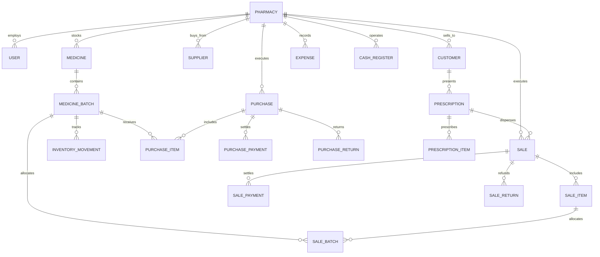

# Database Design Specification: Pharmacy Management System

## 1. Relational Entity Overview

The schema is built for PostgreSQL via Prisma ORM. It enforces multi-tenancy (`Pharmacy` foreign keys), strict referential integrity, immutable historical ledgers, and audit tracking.

---

## 2. Table Specifications & Core Models

### 2.1. Tenant & Organization
- `Pharmacy`: ID, Name, Legal Name, Drug Sale License (DSL) No, NTN, STRN, Phone, Email, Address, City, Timezone, Currency (`PKR`), Logo URL.
- `PharmacySettings`: Low stock threshold, Expiry warning days (30/60/90), Invoice prefix (`INV-`), Receipt footer text, Default tax rate, Thermal printer format (80mm/58mm/A4).

### 2.2. Authentication, Users & RBAC
- `User`: ID, PharmacyId, Full Name, Email, PasswordHash, Phone, Role (`SUPER_ADMIN`, `ADMIN`, `MANAGER`, `PHARMACIST`, `CASHIER`, `INVENTORY_MANAGER`, `ACCOUNTANT`), IsActive, LastLoginAt.
- `Permission`: ID, Code (e.g., `medicines.create`, `sales.refund`, `inventory.adjust`), Description, Module.
- `UserPermission`: Join table for granular role override permissions.
- `AuditLog`: Action, EntityType, EntityId, OldValue, NewValue, UserId, IPAddress, Timestamp.

### 2.3. Master Catalog & Products
- `Category`: ID, Name, Description, Slug, PharmacyId.
- `Manufacturer`: ID, Name, Country, Contact, PharmacyId.
- `Medicine`:
  - `id`: UUID Primary Key
  - `pharmacyId`: UUID Foreign Key
  - `name`: Commercial brand name (e.g., "Panadol CF")
  - `genericName`: Active pharmaceutical ingredient (e.g., "Paracetamol / Pseudoephedrine")
  - `categoryId`: UUID Foreign Key
  - `manufacturerId`: UUID Foreign Key
  - `dosageForm`: Enum (`TABLET`, `CAPSULE`, `SYRUP`, `INJECTION`, `SUSPENSION`, `OINTMENT`, `CREAM`, `DROPS`, `INHALER`, `DEVICE`, `OTHER`)
  - `strength`: e.g. "500mg", "10mg/5ml"
  - `packSize`: Units per commercial pack (e.g., 20 tablets, 1 bottle)
  - `unitOfMeasure`: `BOX`, `STRIP`, `PIECE`, `BOTTLE`, `VIAL`, `TUBE`
  - `barcode`: EAN-13 / Code-128 barcode string (indexed)
  - `sku`: Internal SKU identifier (indexed)
  - `drapRegNo`: Drug Regulatory Authority of Pakistan registration number
  - `prescriptionRequired`: Boolean (Schedule D / Controlled substance flag)
  - `storageCondition`: `ROOM_TEMPERATURE`, `REFRIGERATED_2_8C`, `COOL_DRY_PLACE`
  - `minStockLevel`: Low stock alert trigger
  - `maxStockLevel`: Reorder ceiling
  - `isActive`: Boolean flag

### 2.4. Batch Inventory & Movements
- `MedicineBatch`:
  - `id`: UUID Primary Key
  - `medicineId`: UUID Foreign Key
  - `batchNumber`: Manufacturer batch/lot code (indexed)
  - `expiryDate`: Expiration timestamp (indexed for FEFO lookup)
  - `manufacturingDate`: Production date
  - `purchaseCost`: Unit cost price (`Decimal(12, 2)`)
  - `tradePrice`: Trade price (`Decimal(12, 2)`)
  - `retailPrice`: Maximum Retail Price / MRP (`Decimal(12, 2)`)
  - `quantity`: Current available stock count (integer)
  - `status`: `ACTIVE`, `QUARANTINED`, `EXPIRED`, `DEPLETED`
- `InventoryMovement`:
  - `id`: UUID
  - `batchId`: Foreign key to `MedicineBatch`
  - `type`: `OPENING_STOCK`, `PURCHASE_RECEIPT`, `SALE_DISPENSE`, `SALE_RETURN`, `PURCHASE_RETURN`, `ADJUSTMENT_DAMAGE`, `ADJUSTMENT_EXPIRED`, `ADJUSTMENT_AUDIT`
  - `quantityDelta`: Signed integer (+/-)
  - `balanceAfter`: Balance snapshot
  - `unitCost`: Cost at movement time
  - `referenceId`: Invoice ID, Purchase ID, or Adjustment ID
  - `userId`: Staff responsible
  - `notes`: Audit explanation

### 2.5. Sales & POS Engine
- `Sale`:
  - `id`: UUID Primary Key
  - `invoiceNumber`: Unique human-readable code (e.g., `INV-2026-00001`)
  - `pharmacyId`: UUID Foreign Key
  - `customerId`: UUID Nullable Foreign Key (for walk-ins or registered patients)
  - `prescriptionId`: UUID Nullable Foreign Key
  - `cashierId`: UUID Foreign Key to User
  - `subtotal`: `Decimal(12, 2)`
  - `discountAmount`: `Decimal(12, 2)`
  - `taxAmount`: `Decimal(12, 2)`
  - `totalAmount`: `Decimal(12, 2)`
  - `paidAmount`: `Decimal(12, 2)`
  - `changeAmount`: `Decimal(12, 2)`
  - `paymentStatus`: `PAID`, `PARTIAL`, `UNPAID`
  - `saleStatus`: `COMPLETED`, `HOLD`, `CANCELLED`, `RETURNED`, `PARTIALLY_RETURNED`
  - `createdAt`: Timestamp
- `SaleItem`:
  - `id`: UUID
  - `saleId`: UUID Foreign Key
  - `medicineId`: UUID Foreign Key
  - `quantity`: Integer
  - `unitPrice`: `Decimal(12, 2)`
  - `lineDiscount`: `Decimal(12, 2)`
  - `totalPrice`: `Decimal(12, 2)`
- `SaleBatch`:
  - `id`: UUID
  - `saleItemId`: UUID Foreign Key
  - `batchId`: UUID Foreign Key (links sale item to exact batch deducted)
  - `quantity`: Integer
  - `costPrice`: Cost snapshot for accurate Gross Profit calculation
- `SalePayment`:
  - `id`: UUID
  - `saleId`: UUID
  - `method`: `CASH`, `CARD`, `BANK_TRANSFER`, `CREDIT`, `EASYPAISA_JAZZCASH`
  - `amount`: `Decimal(12, 2)`
  - `reference`: Transaction/auth code

### 2.6. Purchases & Suppliers
- `Supplier`: ID, Name, Contact Person, Phone, Email, Address, NTN, STRN, Balance (`Decimal(12, 2)`), PaymentTerms.
- `Purchase`: ID, PurchaseOrderNo, SupplierInvoiceNo, SupplierId, TotalCost, Tax, Discount, PaidAmount, Status (`PENDING`, `RECEIVED`, `PARTIAL`, `CANCELLED`).
- `PurchaseItem`: PurchaseId, MedicineId, BatchNumber, ExpiryDate, ManufacturingDate, Quantity, PackCost, RetailPrice.
- `SupplierPayment`: SupplierId, PurchaseId, Amount, PaymentMethod, Reference, Note.

### 2.7. Prescriptions & Controlled Substances
- `Prescription`: PatientName, PatientAge, PatientGender, DoctorName, PMDCNumber, ClinicHospital, PrescriptionDate, ImageUrl, VerificationStatus (`PENDING`, `VERIFIED`, `REJECTED`), VerifiedByPharmacistId.
- `PrescriptionItem`: MedicineName, Dosage, Frequency, DurationDays, QuantityPrescribed, QuantityDispensed.

### 2.8. Financial Accounting & Cash Register
- `CashRegister`: TerminalName, OpenedAt, ClosedAt, CashierId, OpeningCash, ExpectedCash, ActualCash, Variance, Status (`OPEN`, `CLOSED`).
- `CashTransaction`: RegisterId, Type (`CASH_IN`, `CASH_OUT`, `SALE_COLLECTION`, `SUPPLIER_PAYMENT`, `EXPENSE`), Amount, Reason, UserId.
- `Expense`: PharmacyId, Category (`RENT`, `UTILITIES`, `SALARIES`, `SUPPLIES`, `LICENSES`, `MAINTENANCE`, `OTHER`), Amount, PaymentMethod, PaidTo, Description, ReceiptUrl, Date.
- `FinancialTransaction`: Double-entry audit ledger tracking Debit/Credit across Accounts (Cash, Accounts Receivable, Inventory, Accounts Payable, Sales Revenue, COGS, Operating Expenses).

---

## 3. Database Indexes & Performance Optimization
- `Medicine(barcode)`: BTREE index for sub-10ms POS barcode scanner lookups.
- `Medicine(name, genericName)`: GIN / pg_trgm index for autocomplete search.
- `MedicineBatch(expiryDate, quantity)`: Compound index for instantaneous FEFO allocation.
- `Sale(invoiceNumber)`: Unique index.
- `Sale(createdAt, pharmacyId)`: Composite index for fast daily/monthly sales reports.
- `InventoryMovement(batchId, createdAt)`: Compound index for audit ledger replay.
