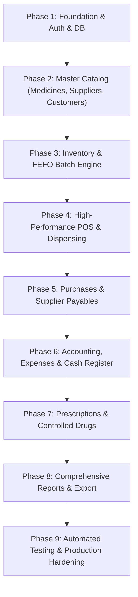

# Master Development Plan: Pharmacy Management System (Pakistan)

## Executive Summary
This document outlines the systematic, multi-phase engineering and delivery plan for a full-stack, enterprise-grade Pharmacy Management System tailored for the healthcare and pharmaceutical retail/wholesale ecosystem in Pakistan (PKR currency, Asia/Karachi timezone, DD-MM-YYYY dates, DRAP regulatory compliance, FEFO batch-tracking, thermal POS printing, and robust financial ledgers).

---

## 1. Project Specifications
- **Operating Environment:** Linux / Kali Linux (Local Dev), Vercel + Hosted PostgreSQL (Neon/Supabase) for Production.
- **Node.js Runtime:** v24.x LTS.
- **Frontend:** Next.js 14+ (App Router), React 18/19, TypeScript, Tailwind CSS, Lucide React, Recharts, TanStack Table.
- **Backend:** Next.js Server Actions, Route Handlers, Server-Side Business Services.
- **Database & ORM:** PostgreSQL 16+ via Prisma ORM with strict foreign keys, indexes, decimal monetary precision, and transaction boundaries.
- **Authentication & Authorization:** NextAuth.js / Auth.js with credentials provider, bcryptjs password hashing, JWT sessions, and granular RBAC.
- **Validation:** Zod schemas shared across client forms and server actions.
- **Reporting & Exporting:** ExcelJS for spreadsheets, CSV streaming parser/generator, and PDF generation with print-ready thermal/A4 layouts.

---

## 2. Roadmap & Implementation Phases

### Phase 1: Foundation & Core Infrastructure
- [x] Environment and dependency inspection.
- [ ] Initialize Next.js App Router with TypeScript and Tailwind CSS.
- [ ] Configure Dark/Light Theme Provider (defaulting to dark mode).
- [ ] Configure Dockerized PostgreSQL for local development and Neon/Supabase compatibility.
- [ ] Configure Prisma schema with tenant-aware pharmacy model, user roles, permissions, audit logs.
- [ ] Implement secure authentication flow (Login, Session, Role verification, password hashing).
- [ ] Establish base layout with collapsible sidebar, navigation, user menu, and notification bell.
- [ ] Build live, database-backed Executive Dashboard with real metrics.

### Phase 2: Master Data Management
- [ ] **Medicines & Catalog:** Generic name, brand name, manufacturer, dosage form, pack size, barcode, DRAP registration, storage condition, min/max thresholds.
- [ ] **Categories & Dosage Forms:** Tablets, Syrups, Injections, Ointments, Drops, Suspensions, Inhalers, Medical Devices.
- [ ] **Manufacturers & Suppliers:** Detailed contact, NTN/STRN, opening balances, payment terms.
- [ ] **Customers:** Patient accounts, contact, credit limits, receivables ledger, loyalty tracking.
- [ ] **Bulk Import/Export:** CSV/Excel importer with duplicate checking and validation.

### Phase 3: Inventory & FEFO Batch Engine
- [ ] **Batch Tracking:** Unique batch numbers, manufacturing dates, expiry dates, purchase cost, retail/trade price.
- [ ] **Allocation Strategies:** First-Expiry-First-Out (FEFO) automated allocation to prevent dead stock.
- [ ] **Stock Movements:** Immutable audit ledger for every stock in/out/adjustment.
- [ ] **Stock Adjustments & Quarantine:** Physical audit reconciliation, breakages, expired stock isolation.
- [ ] **Expiry Alerts:** 30/60/90 days predictive alerts and quarantine triggers.

### Phase 4: Point of Sale (POS) & Checkout
- [ ] **Fast Keyboard-Driven Interface:** Barcode scanner ready, hotkeys (`F2` search, `F4` pay, `F8` hold, etc.).
- [ ] **Cart & Calculations:** Decimal-safe arithmetic for item subtotals, line discounts, invoice discounts, tax rates.
- [ ] **Payment Methods:** Cash, Debit/Credit Card, Bank Transfer (Raast / 1Link), Split Payments, Customer Credit.
- [ ] **Receipt & Invoice Engine:** Thermal 80mm/58mm receipt generation and full-page A4 PDF tax invoices.
- [ ] **Hold & Resume Sales:** Multiple active carts for peak dispensary hours.
- [ ] **Sales Returns & Refunds:** Partial and full returns with inventory disposition (return to sellable vs discard).

### Phase 5: Purchase Management & Supplier Invoicing
- [ ] **Purchase Orders:** Supplier order generation with suggested re-order quantities.
- [ ] **Goods Receiving:** Receiving stock into specific batch numbers, verifying physical vs billed quantities.
- [ ] **Supplier Invoicing & Payables:** Trade discount, batch cost tracking, payment recording, balance management.
- [ ] **Purchase Returns:** Defective/expired stock return to supplier with credit note generation.

### Phase 6: Financial Management & Cash Register
- [ ] **Cash Register Operations:** Opening balance, cash-in, cash-out, daily reconciliation, cashier handovers.
- [ ] **Expense Tracking:** Utility bills, salaries, rent, maintenance, categorized with receipts.
- [ ] **Financial Statements:** Real-time Gross Profit, Net Profit, Cost of Goods Sold (COGS), Cash Flow.
- [ ] **Double-Entry Financial Ledger:** Immutable ledger entries for sales, purchases, payments, and expenses.

### Phase 7: Prescriptions & Controlled Substances
- [ ] **Prescription Records:** Patient details, doctor/hospital info, PMDC number, image attachment upload.
- [ ] **Dispensing Rules:** Enforce pharmacist sign-off for Schedule D / controlled narcotics.
- [ ] **Dispensing Log:** Full audit log of prescribed vs dispensed quantities.

### Phase 8: Reports, Analytics & Exports
- [ ] **Sales Analytics:** Daily, weekly, monthly, annual sales trends with Recharts.
- [ ] **Product & Category Performance:** Fast-moving vs dead inventory, margin analysis.
- [ ] **Inventory Valuation:** Moving average and batch-specific inventory value.
- [ ] **Tax & Audit Reports:** Sales tax summaries, customer ledgers, supplier statements.
- [ ] **Export Engine:** Native Excel (.xlsx), CSV, and printable PDF documents.

### Phase 9: Quality Assurance & Deployment
- [ ] Automated unit and integration testing with Vitest.
- [ ] End-to-end testing scenarios.
- [ ] Security audit: OWASP Top 10, SQLi, XSS, CSRF, rate-limiting, least-privilege RBAC.
- [ ] Vercel deployment configuration & Neon/Supabase pooled connection setup.
- [ ] System documentation and disaster recovery guide.

---

## 3. Pakistani Pharmacy Regulatory & Market Specifics
1. **DRAP Guidelines:** Strict batch number and expiry recording for every sold medicine.
2. **Pricing Structure:** Maximum Retail Price (MRP) regulated by Drug Regulatory Authority of Pakistan, alongside Trade Price (TP) and wholesale discounts.
3. **Currency & Formatting:** PKR with proper grouping (`Rs. 1,50,000.00`).
4. **Thermal Receipt Standards:** Pharmacy registration number, Drug Sale License (DSL) number, NTN/STRN, and non-returnable drug conditions printed clearly.
