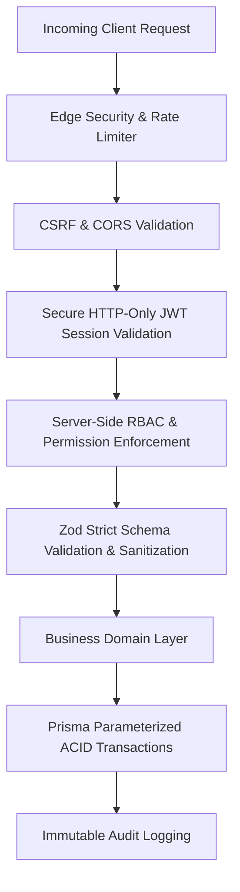

# Application Security & Compliance Architecture

## 1. Threat Modeling & Core Defense Mechanisms

The Pharmacy Management System is engineered adhering strictly to the **OWASP Top 10** guidelines and healthcare data privacy standards.



---

## 2. Authentication & Access Control

### 2.1. Password Security
- Passwords hashed using `bcryptjs` with a cost factor of 12.
- Password complexity requirements enforced via Zod schema (min 8 chars, uppercase, lowercase, number, special character).
- Timing-safe comparisons used during credential verification to eliminate timing attacks.

### 2.2. Session Management
- Sessions stored in encrypted HTTP-Only, SameSite=`lax` (or `strict`), Secure cookies.
- No sensitive session secrets or database credentials exposed to browser client code.
- Automatic session invalidation upon password reset or role revocation.

### 2.3. Role-Based Access Control (RBAC)
Role authorization is strictly validated on the server. Client-side navigation guards provide user experience convenience only; every Server Action and Route Handler executes server-side role and permission checks:
```typescript
// Example authorization enforcement guard
export async function requirePermission(permissionCode: string) {
  const session = await getAuthenticatedUser();
  if (!session || !session.isActive) {
    throw new UnauthorizedError("Authentication required.");
  }
  if (session.role === "SUPER_ADMIN" || session.role === "ADMIN") {
    return session; // Administrators retain superuser override
  }
  const hasPermission = await checkUserPermission(session.id, permissionCode);
  if (!hasPermission) {
    throw new ForbiddenError(`Missing required permission: ${permissionCode}`);
  }
  return session;
}
```

---

## 3. Data Protection & Input Sanitization

### 3.1. SQL Injection Prevention
All database queries utilize Prisma ORM with strictly typed parameterized queries. No raw SQL concatenation is permitted.

### 3.2. Cross-Site Scripting (XSS) Prevention
- React natively escapes interpolated JSX content.
- User-supplied strings in notes, customer records, and prescriptions are sanitized.
- Strict Content-Security-Policy (CSP) headers applied via Next.js response headers.

### 3.3. Cross-Site Request Forgery (CSRF)
- Next.js Server Actions automatically enforce internal CSRF token checks and origin header verification.

---

## 4. Financial & Inventory Integrity

### 4.1. Server-Side Price Verification
- POS client carts submit only `medicineId` and requested `quantity`.
- All prices, discounts, tax rates, and batch allocations are fetched and calculated on the server directly from active database records.
- Any discrepancy between requested price and current catalog price is rejected.

### 4.2. Atomic ACID Stock Operations
- Inventory deductions and cash collections are executed within Prisma interactive transactions (`$transaction`). If stock is exhausted mid-transaction, all operations roll back completely.

### 4.3. Immutable Audit Trails
- Stock movements and financial transactions are append-only.
- Returns and adjustments do not overwrite previous transactions; they append offsetting reversal records with explicit audit reasons.

---

## 5. Healthcare & Patient Privacy (HIPAA / DRAP Compliance)
- Patient prescriptions and clinical history are accessible only to authorized Pharmacists, Managers, and Admins.
- Cashiers cannot view sensitive medical diagnosis records or controlled drug prescription uploads.
- Audit logs capture every view and modification of controlled drug dispensations.
